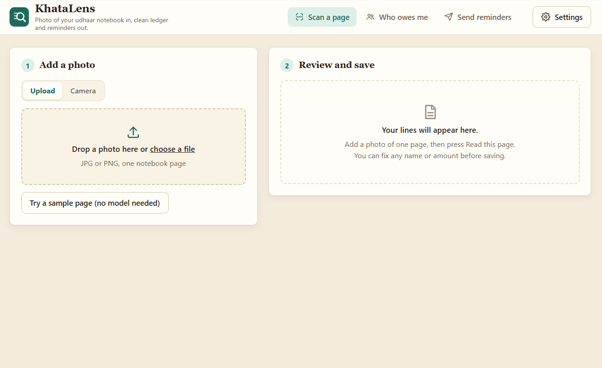
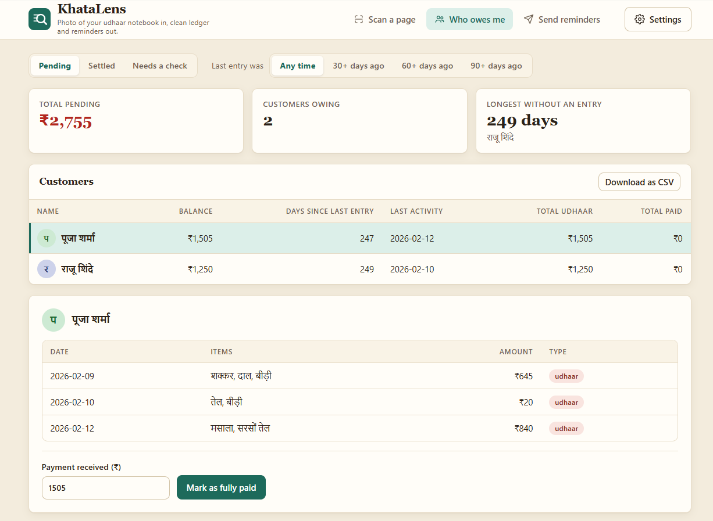
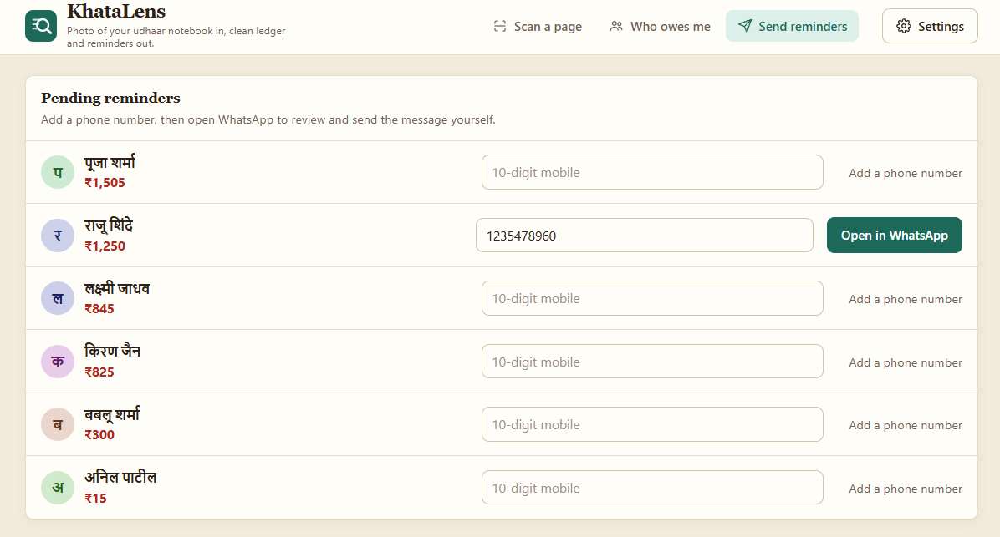
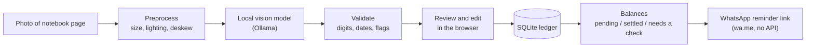
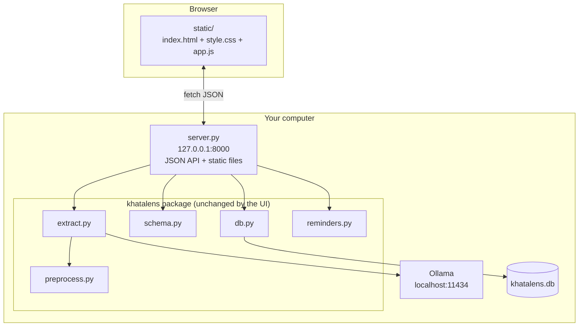

# KhataLens

Photograph a handwritten udhaar (credit) notebook page. Get a clean ledger and one-tap
WhatsApp payment reminders. **Everything runs on the shopkeeper's own computer** using an
open-weight vision-language model served by Ollama. No customer data leaves the machine.

The app is a plain HTML/CSS/JavaScript web page (no build step, no CDN, works offline)
served by a small local Python server that wraps the `khatalens` package.

<p align="center">
  
  
  
</p>


## Quick start

```bash
pip install -r requirements.txt
ollama pull qwen2.5vl:7b          # or any vision model your hardware can run
python scripts/synth_ledger.py --n 20 --out data/synth    # sample pages for the demo
python server.py                  # opens http://127.0.0.1:8000
```

Click **Try a sample page** to test the review -> save -> remind flow with no model, or
upload / photograph a real page and click **Read this page**. Use another model with
`KHATALENS_MODEL=<name>` or in **Settings** (this is where your fine-tuned model plugs in).

Server options:

```bash
python server.py --port 9000        # different port
python server.py --no-browser       # do not open a browser tab
```

> The server listens on `127.0.0.1` only. `--host 0.0.0.0` exposes it to your network and
> there is **no login**, so only use it on a network you trust.

## How it works



## Architecture



## Features

- **Scan a page** - upload (drag and drop) or use the camera, or load a sample page that
  needs no model. Every extracted line is editable before saving; suspicious lines are
  highlighted with a reason in the check column.
- **Who owes me** - three views, a summary row (total pending, customers owing, longest
  without an entry), a "last entry was 30/60/90+ days ago" filter, per-customer history,
  full or partial payments, and CSV download.
- **Send reminders** - add a phone number once, then open WhatsApp with the message
  prepared in Hindi, Marathi, Tamil or English. Nothing is sent automatically; you review
  and send it yourself.
- **Settings** - shop name, vision model, year of the page, reminder language, and a
  theme (Clean, Ledger or Midnight). Settings are remembered in the browser.

### Customer status

**Needs a check** lists customers whose payments add up to more than their recorded
udhaar. Common causes: an older page not scanned yet, a payment scanned twice, the same
person written with two names, or a misread amount. In this view only, each history line
has a **Delete** button (with a confirmation) so a wrong or duplicate line can be removed.
The server enforces this: deleting is refused for any customer who is not currently under
Needs a check.

### Data model

Balance = total `udhaar` minus total `payment`. Pending is above zero, Settled is exactly
zero, Needs a check is below zero.

## Layout

| Path | Purpose |
|---|---|
| `server.py` | Local web server: serves `static/` and a small JSON API over the package |
| `static/index.html`, `style.css`, `app.js` | The web UI (plain HTML/CSS/JS, three themes, no external requests) |
| `khatalens/extract.py` | Image -> JSON via local Ollama, with structured-output schema |
| `khatalens/schema.py` | Validation: Devanagari digits, dates, flags suspicious rows |
| `khatalens/preprocess.py` | Size, lighting (CLAHE), deskew |
| `khatalens/db.py` | SQLite ledger, balances (pending / settled / check), payments, entry delete |
| `khatalens/reminders.py` | Reminder text (hi/mr/ta/en) + `wa.me` links (no WhatsApp API) |
| `scripts/synth_ledger.py` | Synthetic handwritten-style pages + LLaMA-Factory training file |
| `scripts/evaluate.py` | Field-level accuracy: open base vs fine-tuned vs closed API |
| `tests/test_core.py` | Tests for the core package |
| `app.py` | Original Streamlit UI (optional, see below) |

## Local API

Used by the web UI; all endpoints are local and return JSON.

| Method | Path | Purpose |
|---|---|---|
| GET | `/api/config` | Default model, year, languages, whether sample pages exist |
| GET | `/api/sample` | Random sample page with its entries (no model) |
| POST | `/api/extract?model=&year=` | Body is the image; returns entries + raw model output |
| POST | `/api/entries` | Validate and save reviewed entries |
| GET | `/api/balances?status=&days=` | `status` is `pending`, `settled` or `check` |
| GET | `/api/history?name=` | A customer's entries |
| GET | `/api/entry-history?name=` | Same, with entry ids (Needs a check view) |
| POST | `/api/entry-delete` | Delete one entry; only for customers under Needs a check |
| POST | `/api/payment` | Record a full or partial payment |
| GET | `/api/reminders?shop=&lang=` | Pending balances with phone and WhatsApp link |
| POST | `/api/phone` | Save a customer's phone number |

## Configuration

| Setting | Default | Notes |
|---|---|---|
| `KHATALENS_MODEL` | `qwen2.5vl:7b` | Default vision model name (also editable in Settings) |
| `OLLAMA_HOST` | `http://localhost:11434` | Where Ollama is running |
| `--port` | `8000` | `server.py` option |

The ledger is stored in `khatalens.db` in the project folder. **Back this file up**; it
holds all customer data. Run `python server.py` from the project folder.

## Evaluate (the table for your write-up)

```bash
python scripts/evaluate.py --labels data/test/labels.jsonl --backend ollama --model qwen2.5vl:7b
python scripts/evaluate.py --labels data/test/labels.jsonl --backend ollama --model khatalens-ft
python scripts/evaluate.py --labels data/test/labels.jsonl --backend anthropic --model <closed-model>
```

Put your own handwritten pages in `data/test/` (same `labels.jsonl` format). **Never train on
them.** Synthetic pages are for training; real/own handwriting is for testing.

## Tests

```bash
pytest
```

## Legacy Streamlit UI

`app.py` is the original Streamlit interface. It uses the same package and database, so it
still works (`streamlit run app.py`), but it needs `streamlit` and `pandas`, which the web
UI does not. The web UI is the main interface going forward.
